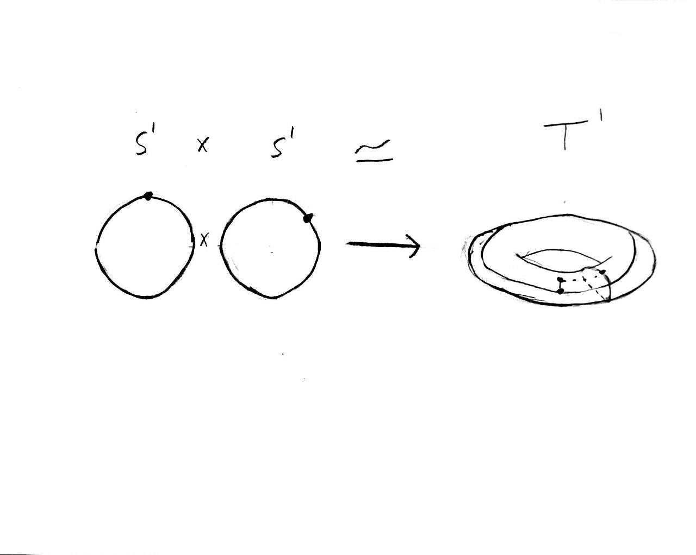
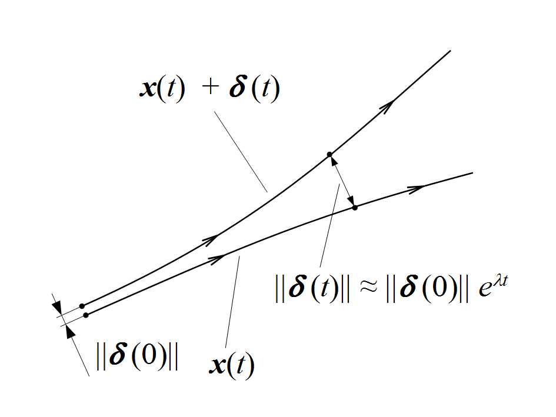
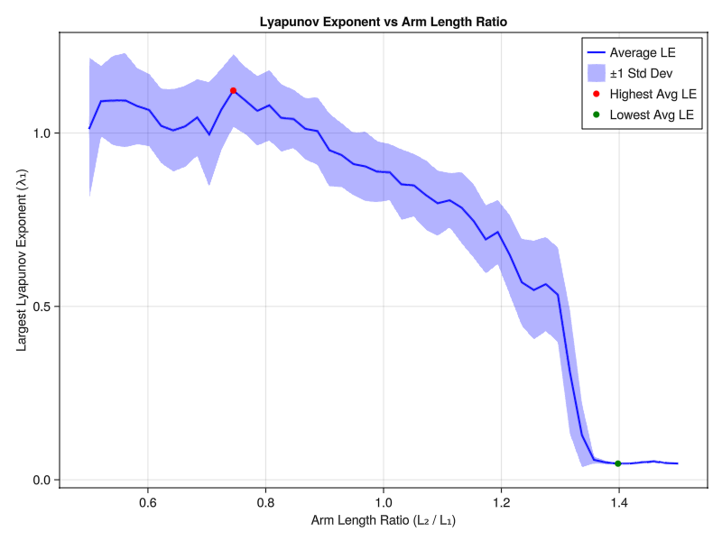
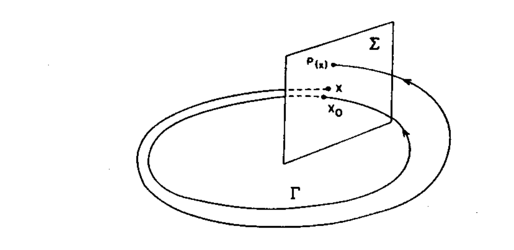
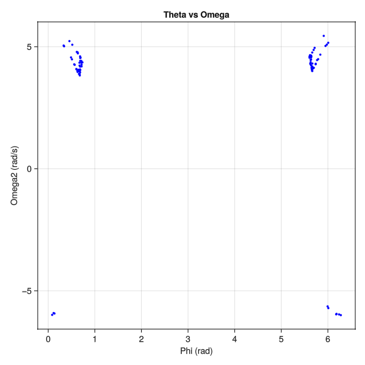
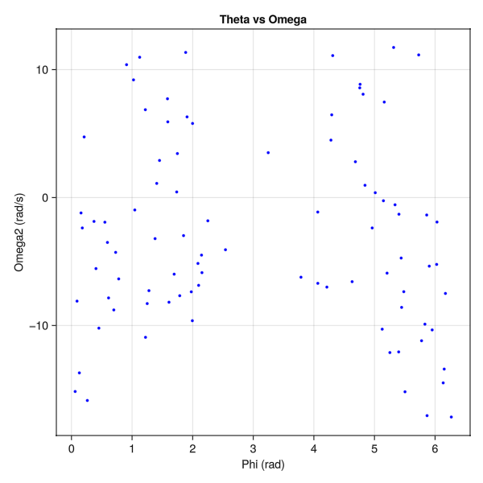

*Note: This was written for my final project in my computational physics class.*

## Introduction

Consider a single-armed pendulum, the dynamics of which are described by the following equations:

$$
\frac{d\theta}{dt} = \frac{p}{mL^2}, \quad\quad \frac{d\omega}{dt} =  -m g L \sin(\theta)
$$

Here, $\theta(t)$ is the angular displacement relative to the vertical axis, $\omega(t)$ is the angular momentum, $g$ is the acceleration due to gravity, and $L$ is the length of the pendulum.

Animating the pendulum and its trajectory in phase space for given initial parameters:

Notice that in the phase space representation, there appears to be redundant data. This arises because the angular coordinate is effectively defined modulo $2\pi$. Physically, the state of the pendulum is indistinguishable after a full rotation. Consequently, it is more natural to think of the phase space as having a circular coordinate for the angle and a real line for the momentum. Topologically, our phase space is $S^1 \times \mathbb{R}$, which is a cylinder. Thus, phase space trajectories occur on the surface of a cylinder.

<figure>
<video controls preload="metadata" src="../Chaotic_Sys_blog/pendulums_sepratix.mp4"></video>
</figure>

The black trajectory is the separatrix, that is, the trajectory separating trajectories which fully rotate in a circle and oscillate between two angles.

By adding an additional arm to the end of the pendulum, we obtain the double pendulum, a classic example of a chaotic system. The dynamics of the double pendulum can be derived from its Hamiltonian:

$$
\begin{aligned}
  H = & \ \frac{1}{2}m_1 l_\theta^2 \dot{\theta}^2
  + \frac{1}{2}m_2 \big[ l_\theta^2 \dot{\theta}^2
  + l_\phi^2 \dot{\phi}^2
  + 2 l_\theta l_\phi \dot{\theta} \dot{\phi} \cos(\theta - \phi) \big] \\
  & - m_1 g l_\theta \cos\theta
  - m_2 g \big[ l_\theta \cos\theta + l_\phi \cos\phi \big]
\end{aligned}
$$

Using Hamilton's equations:

$$
\begin{aligned}
  \dot{\theta}  &= \frac{\partial H}{\partial p_{\theta}}, \quad\quad \dot{\phi} = \frac{\partial H}{\partial p_{\phi}}\\
  \dot{\omega}_{\theta}  &= -\frac{\partial H}{\partial \theta}, \quad\quad \dot{\omega}_{\phi} = -\frac{\partial H}{\partial \phi}
\end{aligned}
$$

By similar reasoning to the single-armed pendulum, we find that the phase space of the double pendulum is $S^1 \times S^1 \times \mathbb{R}^2.$ Since $S^1 \times S^1$ is topologically equivalent to a torus $T^1$, the configuration space forms a torus. Specifying a point on two circles corresponds to specifying a point on a donut-shaped surface.

Mathematicians call this relation a homeomorphism, symbolically written as $S^1 \times S^1 \simeq T^1$. Thus, the phase space of the double pendulum can be $T^1 \times \mathbb{R}^2$, known as the cotangent bundle of the torus $T^*(T^1)$ (momentum is dual to velocity via the Legendre transformation, so the $\mathbb{R}^2$ where momenta reside is the dual vector space to the velocity space.).

Hence, unlike the single-armed pendulum’s two-dimensional phase space, the double pendulum’s phase space is four-dimensional.

## Chaos

Consider again the single-armed pendulum. Suppose we choose two close initial conditions $(\theta_0, \omega_0)$ and $(\theta_0+\varepsilon, \omega_0+\varepsilon)$, $\varepsilon$ is very small. If $\phi_t$ denotes the pendulum’s trajectory, we find that the distance between $\phi_t(\theta_0, \omega_0)$ and $\phi_t(\theta_0+\varepsilon, \omega_0+\varepsilon)$ remains small and grows at most linearly with time $t$. This reflects the stability and regular nature of the single-armed pendulum’s motion.

In contrast, for the double pendulum, the distance between two such trajectories can grow exponentially with $t$, indicating extreme sensitivity to initial conditions. This exponential divergence leads us to ask: how can we quantify the rate at which nearby trajectories separate?

## Lyapunov Exponent

To measure how rapidly two nearby trajectories in the double pendulum’s phase space diverge, we introduce the Lyapunov exponent $\lambda$. A positive $\lambda$ implies exponential sensitivity to initial conditions, a defining feature of chaos.

To estimate $\lambda$, consider a reference trajectory $u_1(t)$ and another trajectory $u_2(t)$ that starts a small distance $\delta$ away in phase space. As both evolve, we record their separation at discrete time intervals. If the average growth of their separation behaves like $e^{\lambda t}$, then $\lambda$ quantifies how chaotic the system is.

**Algorithm**

1.  Choose a trajectory $u_1(t)$ and a small initial displacement $\delta$.
2.  Define $u_2(t)$ so that $u_2(x_0) = u_1(x_0+\delta)$.
3.  Evolve both trajectories over a total time $T$, sampling at $n$ equally spaced points $t_i$.
4.  At each sample point $t_i$, measure the distance $d(t_i)$ between the two trajectories.
5.  Compute growth rates: $a_i = \frac{d(t_i)}{d(0)}$ for $i = 1, \ldots, n$.
6.  Average the logarithms of these ratios over time to estimate $\lambda$: $\lambda = \frac{1}{t_n - t_0} \sum_{i=1}^n \ln(a_i).$

Repeat this procedure multiple times with different random initial displacements $\delta$ and average the results for a more robust estimate of $\lambda$.

The above algorithm is implemented in Julia's ChaosTools library, using it we plotted the Lyapunov exponent as a function of the ratio of the arm lengths $(L_2/L_1)$:

The upper and lower bands represent one standard deviation from the mean (the blue line).

To build further intuition, for both the largest and smallest Lyapunov exponents found, we plot 20 pendulums whose initial angles differ by only $10^{-3}$:

<figure>
<video controls preload="metadata" src="../Chaotic_Sys_blog/20LOWLE.mp4"></video>
<figcaption>Low Lyapunov Exponent</figcaption>
</figure>

<figure>
<video controls preload="metadata" src="../Chaotic_Sys_blog/20HIGHLE.mp4"></video>
<figcaption>High Lyapunov Exponent</figcaption>
</figure>

## Poincaré Map

Generally, most trajectories in a chaotic system are indeed chaotic. However, some trajectories may exhibit periodic or quasi-periodic behavior, settling into repeating patterns or closed loops in phase space. To visualize and distinguish these special trajectories from the chaotic background, we use the Poincaré map.

By choosing a lower-dimensional slice of the phase space and examining how trajectories intersect this slice over time, the Poincaré map reveals underlying structures that are hard to discern in the full, high-dimensional dynamics. Periodic trajectories appear as a finite set of points, quasi-periodic orbits form smooth, closed curves, and chaotic trajectories produce seemingly random, scattered points.

For the double pendulum, we construct the Poincaré map by taking a transversal slice of the phase space. Since the system is conservative, we can think of this slice as taken from $T^1 \times \mathbb{R}$, recording where trajectories pierce a chosen section of the torus.

In the following animations, red dots on the torus represent each time the trajectory intersects the transverse plane. These intersection points are then recorded on the Poincaré map, providing a clearer view of the system’s underlying behavior—whether periodic, quasi-periodic, or chaotic.

<figure>
<video controls preload="metadata" src="../Chaotic_Sys_blog/LOWLEPOINCARE.mp4"></video>
<figcaption>Poincaré map for low Lyapunov exponent</figcaption>
</figure>

<figure>
<video controls preload="metadata" src="../Chaotic_Sys_blog/HIGHLEPOINCARE.mp4"></video>
<figcaption>Poincaré map for high Lyapunov exponent</figcaption>
</figure>

Looking at the low Lyapunov exponent example, we see that the points on the Poincaré map are much denser, compared to the high Lyapunov exponent case, where the dots are spread out. If we were to identify periodic or quasi-periodic orbits, we'd see finitely many points, or points which are dense in some region.

## Conclusion

We demonstrated how considering the topology of phase space provides deeper intuition to the nature of chaos and tools used to study it.

There are a lot of exciting directions to extend this work, for example, it would be nice to make these animations interactive. Additionally we could implement a theory called symbolic dynamics, which allows you to (approximately) identify periodic orbits, periodic orbits are of 'measure zero' in chaotic systems, so they are hard to stumble across, and difficult to numerically simulate. Additionally, it would be nice to have a more convincing animation for the Poincaré map, perhaps attaching the momentum vector instead of the red points, since the momentum appears out of 'nowhere' on the plot.

## Code

- [Double Pendulum Plotting](../Chaotic_Sys_blog/double_pendulum.jl)
- [Lyapunov Exponent Plotting](../Chaotic_Sys_blog/LE_Plot.jl)
- [Single-Armed Pendulum Plotting](../Chaotic_Sys_blog/phaseplotpend.jl)
