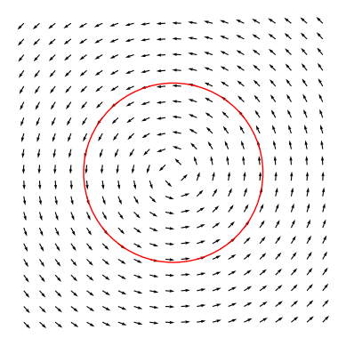

## Introduction

During the current academic year I have been working on research pertaining to symmetries of PDEs. In this post I'd like to briefly explain the method, and then explain why the 'modern' method, utilizing the variational derivative, is computationally and conceptually clearer than the historical version (which is still often used).

## Algebraic equations

To start, consider a circle. We can rotate and reflect a circle and it will look the same. How can we express this mathematically?

In the plane we can express a circle with radius $r$ as the set of points satisfying the algebraic equation $x^2 + y^2 = r$, a symmetry of the circle should leave this algebraic equation unchanged. A rotation $R(\theta)$ in the plane is described by the linear transformation

$$
\begin{pmatrix}
x' \\ y'
\end{pmatrix}
=
\begin{pmatrix}
\cos\theta & -\sin\theta \\
\sin\theta & \cos\theta
\end{pmatrix}
\begin{pmatrix}
x \\ y
\end{pmatrix}
$$

and a reflection is described by

$$
\begin{pmatrix}
x' \\ y'
\end{pmatrix}
=
\begin{pmatrix}
\cos\theta & \sin\theta \\
\sin\theta & -\cos\theta
\end{pmatrix}
\begin{pmatrix}
x \\ y
\end{pmatrix}
$$

Let's check by substitution if rotation is indeed a symmetry:

$$
\begin{aligned}
x'^2+y'^2 &=(x\cos\theta -y\sin\theta)^2+ (x \sin\theta + y\cos\theta)^2\\ &=x^2(\cos\theta^2+\sin\theta^2)+y^2(\sin\theta^2+\cos\theta^2)+xy(-\sin\theta\cos\theta+\sin\theta\cos\theta)\\ &= x^2+y^2
\end{aligned}
$$

Next, we want to think about how a circle can be infinitesimally rotated, what does that even look like? The picture is we want each point to walk infinitesimally in the direction of its tangent vector. Mathematically this corresponds to the derivative of the rotation matrix evaluated at zero:

$$
\frac{d}{d\theta}\Bigr|_{\theta=0}
\begin{pmatrix}
\cos\theta & -\sin\theta \\
\sin\theta & \cos\theta
\end{pmatrix} =
\begin{pmatrix}
0 & -1 \\
1 & 0
\end{pmatrix}
$$

This transformation is called the infinitesimal generator of a rotation.

From this it is easy to see that $x^2+y^2$ remains invariant. An important thing to note here is that the expression for an infinitesimal rotation is simpler than that of a finite rotation.

Finally, we can represent an infinitesimal rotation as an action on functions, this will reduce the problem of finding symmetries to one of solving a PDE. First note that we can define a representation of $G$ to act on functions by $(\pi(g)f)(x) = f(g^{-1}x)$. So, an infinitesimal rotation acts on a function $f(x,y)$ by $f( \begin{pmatrix} 0 & 1 \\ -1 & 0 \end{pmatrix} \begin{pmatrix} x \\ y \end{pmatrix}) = f(y, -x)$. Since we want this transformation to be infinitesimal we compute the first order Taylor expansion of $f(y, -x)$, this gives $y\partial_x f - x\partial_y f$.

Therefore, we can conclude that an algebraic equation is rotationally symmetric if the rotational vector field vanishes on the equation.

## Symmetries of Differential equations

In the previous example, we saw how symmetries correspond to vector fields, which can be solved as a linear PDE to yield classes of algebraic equations that are invariant under that symmetry. We will now develop an analogous method for PDEs, such that if we know the symmetries of a PDE, we can generate classes of solutions invariant under those symmetries.

First order of business is to understand how symmetries act on PDEs, then develop a procedure which takes a PDE and gives its symmetries.

## Jet Space

We will denote the space of independent variables, like $x, y, z$ in $\mathbb{R}^3$, with $X$, and the space of dependent variables, that is variables $u$ which depend on $x \in X$, with $U$. We know how transformations act on $X$, so how do they act on $U$?

Consider the action of $SO(2)$ on $X \times U \simeq \mathbb{R} \times \mathbb{R}$ where $(x, u)$ is transformed into $(\tilde{x}, \tilde{u})$, then
$$
(\tilde{x}, \tilde{u}) = g(\theta)(x, u) = (x \cos \theta - u \sin \theta, x \sin \theta + u \cos \theta)
$$
Now for example, take $u = f(x) = ax + b$, under the same transformation this gives
$$
(\tilde{x}, \tilde{f}(\tilde{x})) = ((x \cos \theta - (ax + b) \sin \theta), x \sin \theta + (ax + b) \cos \theta)
$$
Isolating $x$ we have
$$
x = \frac{\tilde{x} + b \sin \theta}{\cos \theta - a \sin \theta},
$$
and subbing into the expression for $\tilde{f}(\tilde{x})$ we get that $f$ transformed under the action of $SO(2)$ is
$$
\tilde{f}(\tilde{x}) = \frac{\sin \theta + a \cos \theta}{\cos \theta - a \sin \theta} \tilde{x} + \frac{b}{\cos \theta - a \sin \theta}
$$

Next, we'd like to prolong group action into "jet space", that is, extend our transformations to the derivatives of $u$. This will allow us to apply group actions to PDEs and determine their invariance.
